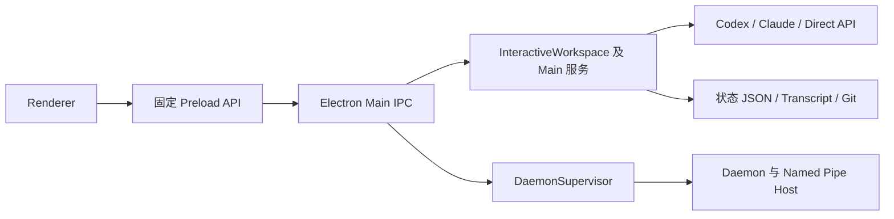

# ADR-0007：正式工作区服务归属与 Daemon 迁移

- 状态：Accepted（迁移约束已确定，实现按后续日任务推进）
- 日期：2026-10-16
- 对应任务：T-LT-D029；前置：[G-LT-01](../spikes/G-LT-01-reliability-baseline.md)
- 依据：[架构方案](../../本地多Agent工作台_完整架构与实施方案.md)第 6、7、11、24、25 章；[每日计划](../roadmap/daily-commit-calendar.md)阶段 2、3

## 当前正式调用链

本记录针对非 smokeMode 的桌面入口，不能从独立包的合同测试推断业务已接入 Daemon。

[preload/index.cjs](../../apps/desktop/preload/index.cjs)通过 workspace:snapshot 和 workspace:command 调用 [main.ts](../../apps/desktop/electron-main/main.ts)。Main 在 app.whenReady 中启动 Supervisor 后，仍在自身创建 InteractiveWorkspace；正常退出同时执行工作区 shutdown、终端 shutdown 和 Supervisor release。Daemon 保留模式本身不能证明正式会话会继续执行。

| 用户操作 | 当前实际处理方 | 当前数据或副作用 |
| --- | --- | --- |
| 新建/分支/归档会话、Team | Main 内 InteractiveWorkspace | 项目/会话/团队状态、Git 分支和 Worktree |
| 发送、中断、恢复 | Main 内工作区编排 | CodexAppServerClient、ClaudeCodeClient、ApiRuntimeClient；活动 Turn 与取消句柄 |
| 权限答复与活动 | Main 内审批 Map、事件和子代理投影 | Runtime 答复、界面投影；不是统一的 Daemon Permission Broker |
| 配置 Provider、MCP、定时任务 | Main 内 ProviderRegistry、WorkspaceCapabilities | 凭据引用、登记文件、配置所有权、15 秒调度器 |
| 对话与模型历史 | Main 内 Transcript Store、API History | 分段 JSONL、索引；模型上下文独立于界面事件缓存 |
| Git、Checkpoint、导入和 Integration | Main 内工作区及相邻服务 | 同步 Git、独立清单/导入记录、检查点与集成状态 |
| Terminal、Computer Use | Main 内 TerminalManager、ComputerUseManager | 本地进程、设备交互和审批入口 |
| 窗口、托盘、对话框、剪贴板、打开链接 | Electron Main | 桌面系统 API |

源码依据：[InteractiveWorkspace](../../apps/desktop/electron-main/interactive-workspace.ts)、[WorkspaceCapabilities](../../apps/desktop/electron-main/workspace-capabilities.ts)、[Transcript Store](../../apps/desktop/electron-main/transcript-store.ts)、[ProviderRegistry](../../apps/desktop/electron-main/provider-registry.ts)。

[Daemon main](../../apps/daemon/src/main.ts)当前负责启动、版本控制、租约与 Named Pipe Host 生命周期；没有装配 InteractiveWorkspace 或 LocalDatabase 业务存储。[Named Pipe Host](../../apps/daemon/windows/named-pipe-host.ps1)已有认证、事件补发和快照合同，但不能将其夹具投影当成正式工作区数据。[database](../../packages/database/src/repository.ts)、project-manager、worktree-manager、git-service、permission-broker 等包已有独立能力，应复用经过验证的行为，不能仅用更换 import 来宣布迁移完成。

## 决策：先抽取和统一存储，再搬进程

正式链路最终采用 Renderer → 固定 Preload → Main 桥接 → 已认证 IPC → Daemon 服务 → Repository/Adapter。Main 保留窗口、系统对话框、托盘、通知、更新、受控文件选择和 Daemon 启停；业务状态、Runtime、调度、PTY、审批、事件和恢复由 Daemon 负责。

Computer Use 的设备交互目前也在 Main。后续应将业务审批与操作归因接入同一 Daemon Broker，设备执行进程及协议另行验收；本 ADR 不将现有桌面控制视为已支持后台执行。

服务首先从 InteractiveWorkspace 抽出，通过依赖注入接收 Repository、Runtime、Git 和事件接口；过渡期仍由 Main 装配。抽取不改变现有 Host/Runtime ID、错误脱敏、恢复顺序或事件预算。成熟能力优先复用现有 packages；缺失的正式编排接口另行定义，不将 Electron 类型传入领域包。具体接口由 D030–D037 的实现和合同测试确定。

| 数据/资源 | 切换前唯一执行方 | 切换后唯一执行方 | 必须保留的边界 |
| --- | --- | --- | --- |
| 项目、会话、团队、配置与凭据引用 | Main 的工作区 Repository | Daemon 的同一 Repository | 稳定 ID、关联约束、版本拒绝；不双写旧 JSON |
| 模型消息、事件、检查点与导入引用 | Main 对应存储服务 | Daemon 对应存储服务 | 完整模型消息与 UI 投影分离，序号/来源可追溯 |
| Runtime 进程和 Turn | Main 生命周期服务 | Daemon Runtime/Turn 服务 | 一个执行者、先 resume 后 Turn、进程身份与连接 epoch |
| 权限和不确定操作 | 当前正式处理服务 | Daemon Broker/Recovery 服务 | 旧 epoch 答复拒绝，不重放已有副作用 |
| Git、Worktree、MCP 托管配置 | 当前 Main 服务 | Daemon 服务及按 Worktree 排队的 Git 执行器 | 所有权校验、路径校验、dirty 保留、独立用户条目保留 |
| 认证秘密 | 系统凭据库，经当前所有者按需读取 | 系统凭据库，经 Daemon 按需读取 | IPC/SQLite/JSON 只存引用；原生 Runtime 认证不复制 |
| 原生窗口和文件选择 | Main | Main | 将选择结果交给业务方验证；不直接修改业务存储 |

这里的“唯一执行方”是迁移要求，不表示现有文件已具备跨进程写锁。现有 app 单实例约束不能替代 D050 的数据实例保护；目前仍有多个 JSON 写入口，需要逐一登记并迁出。

## 顺序与进入条件

1. **D030–D035：抽出正式编排和命令合同。** 会话创建、Turn/取消、事件转换和结构化命令仍走真实 Main 入口。新增通路必须与现有行为回归对齐，不能另起一套仅用于演示的服务。
2. **D036–D042：Repository、Schema 和离线迁移。** 清点状态 JSON、Transcript 分段、模型消息、Provider 引用、MCP 所有权、Schedule、Integration、Checkpoint、导入 Manifest、子代理投影和审计数据。逐项定义迁移或明确保留方式；先 dry run、备份和幂等导入，验证数量、引用、校验和及中断恢复，不修改源文件。
3. **D043–D055：Main 使用统一存储。** 逐域切换读取和写入，旧 JSON 只作备份/兼容读取；补异步 Git 队列、单写入方保护、事件幂等与退出落盘。统一存储发生在搬进程之前；G-LT-02 必须验证真实入口默认数据源及恢复路径。
4. **D057–D060：装配 Daemon 并协商所有权。** 初期只能在只读或独立测试数据中运行，不与 Main 同时执行真实任务。现有 lease 只证明进程/IPC 身份，不作为业务写入所有权。完成显式切换协议后才开放 Daemon 写命令。
5. **D061–D077：按能力迁入执行。** 顺序为 Codex 生命周期、Claude、Direct API、统一审批、恢复与事件补发、定时调度。每项需保持原生 ID、凭据隔离和失败语义；尚未迁移的能力明确由旧所有者执行，不能双开。数据写入通过当前唯一 Repository 所有者提交。
6. **D078–D083：退出/后台策略与默认切换。** 验证 Main 强退、Daemon 强退、旧连接、进程清理；通过后禁用遗留 Main 业务写入口。G-LT-03 验收完整故障矩阵，不能以 Daemon 可连通代替正式任务已归属 Daemon。

## 所有权交接与回退约束

交接单位是一个 userData 数据实例。切换时旧所有者先停止接收新写命令、暂停调度，等待或经明确动作结束活动 Turn 和 Git 操作，完成落盘并交出数据所有权。新所有者核验 Schema、数据实例、进程身份和最后确认游标后获取排他所有权，增加 owner epoch，桌面才更新路由。旧 epoch 的命令与审批一律拒绝。

不以“租约过期”或单独 PID 推断进程已经死亡。接管须核验启动时间、实例和 spawn nonce；无法确认则进入只读/恢复状态。切换失败时保留可归因的旧状态，不同时启动备用执行者；Daemon 不可达时不能静默回退到 Main 写入。

迁移失败可在新库未激活时恢复旧库；新 Schema 已接收写入后，不允许旧版本继续写旧 JSON。降级要使用验证过的兼容读取或显式备份恢复，不能依赖持续双写。用户选定的仓库文件、Git 工作区和原生 Runtime 历史不属于自动可回滚事务；恢复必须报告已知/未知结果，不重放 Prompt、Commit 或 Merge。

## 未采用的方案与验收要求

不直接把整个 InteractiveWorkspace 复制进 Daemon：这会把同步 Git、全量状态写入、Electron 相关依赖和分散清单一起搬过去。也不先让 Main/Daemon 共享一个可写目录再补锁，不在两端各维护活动 Turn、审批和定时队列。

每次抽取必须通过正式入口合同、重启续聊、失败脱敏和 ID 隔离测试；存储切换验证不完整写入、重复导入、版本不兼容和源数据保留；进程切换验证两个 GUI/旧 owner 拒写、事件补发无重复、过期审批失效、无孤儿进程和无秘密扩散。通过范围必须区分离线夹具与真实 Runtime，不提高 unknown/degraded 能力等级。

代价是过渡期保留旧文件读取和装配层，迁移完成前部分后台行为仍受 Main 生命周期限制。回报是每次切换有唯一写入者、可检验的数据归属和明确回退边界；本 ADR 本身不改变运行行为。
